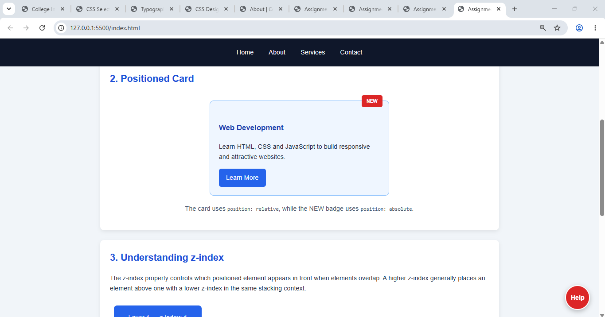
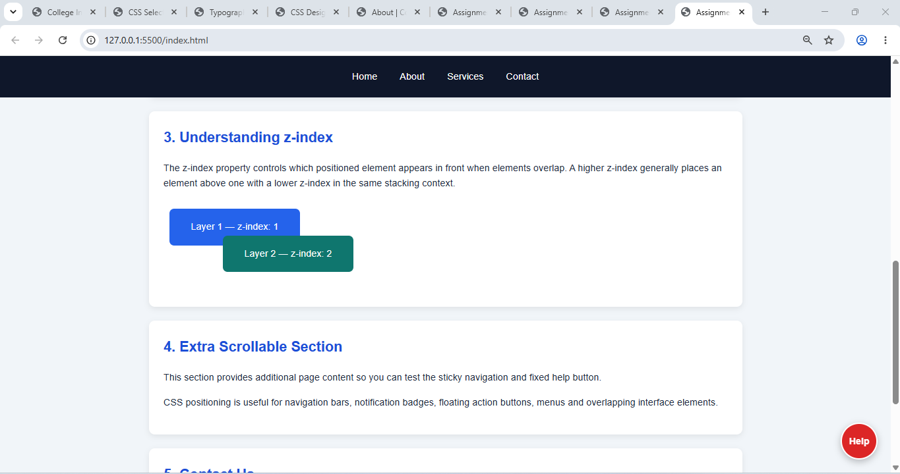
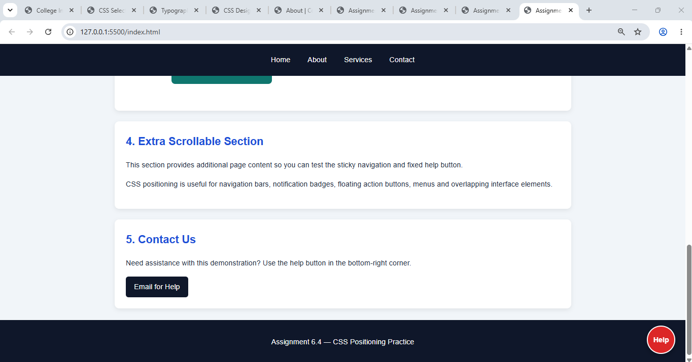

# Assignment 6.4 — Positioning Practice

Aim: To understand and demonstrate CSS positioning using `sticky`, `fixed`, `absolute`, `relative`, and `z-index`.

## 1. Explanation of CSS positioning

| Property             | Purpose                                                             | Used in                  |
| -------------------- | ------------------------------------------------------------------- | ------------------------ |
| `position: sticky`   | Keeps navigation near the top while scrolling.                      | `.navbar`                |
| `position: fixed`    | Keeps the help button in the same screen position.                  | `.floating-help`         |
| `position: relative` | Establishes the reference point for an absolutely positioned child. | `.card`                  |
| `position: absolute` | Positions the badge relative to the card.                           | `.badge`                 |
| `z-index`            | Controls stacking order when elements overlap.                      | Navbar, badge and layers |

### SCREEN SHOTS

index.html created

